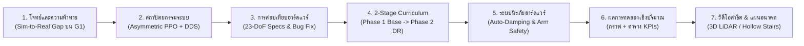

# คู่มือการออกแบบการทดลอง ตัวชี้วัด (KPIs) และแนวทางการนำเสนอผลงาน (Presentation Guide)
**โปรเจกต์: Sim-to-Sim & Sim-to-Real Reinforcement Learning Locomotion สำหรับหุ่นยนต์ฮิวแมนนอยด์ Unitree G1 (23-DoF)**

เอกสารนี้ออกแบบตามมาตรฐานงานวิจัยและวิศวกรรมหุ่นยนต์ชั้นนำ (เช่น ETH Zurich RSL, NVIDIA Isaac Lab, Berkeley Humanoid) เพื่อให้คุณสามารถเก็บผลการทดลองได้อย่างเป็นระบบ มีตัวเลขเชิงปริมาณที่ชัดเจน และนำไปจัดทำสไลด์หรือวิดีโอพรีเซนต์ได้อย่างน่าเชื่อถือที่สุด

---

## ส่วนที่ 1: การออกแบบการทดลอง 4 ชุดมาตรฐาน (4 Core Experimental Suites)

เพื่อให้ครอบคลุมทั้ง **ความนิ่ง (Stability)**, **ความแม่นยำ (Accuracy)**, **ความทนทาน (Robustness)** และ **ความปลอดภัย (Safety)** แนะนำให้แบ่งการทดลองออกเป็น 4 ชุดดังนี้:

### การทดลองที่ 1: ทดสอบความนิ่งขณะยืนทรงตัวและการลดอาการสั่น (Static Standing & Jitter Ablation)
* **วัตถุประสงค์:** พิสูจน์ว่าหุ่นสามารถยืนนิ่งสนิทเมื่อคำสั่งความเร็วเป็นศูนย์ (`cmd = 0`) โดยไม่ซอยเท้าค้าง และไม่เกิดอาการแขนกระตุก (Arm Jitter) ที่เป็นอันตรายต่อฮาร์ดแวร์
* **เงื่อนไขเปรียบเทียบ (Ablation):**
  1. *Before Fix:* ก่อนแก้บั๊กการแมป `kp`/`kd` ข้ามช่องของโมเดล 23-DoF
  2. *Phase 1 (Iter 10,000):* โมเดลพื้นฐานหลังแก้บั๊ก `kp`/`kd`
  3. *Phase 2 (Iter 13,000):* โมเดลที่ผ่านการเทรน Domain Randomization ครบ 6 มิติ
* **วิธีเก็บผล:** ให้หุ่นยืนนิ่งในโหมด `Velocity` เป็นเวลา `15 วินาที` เก็บค่าความสั่นของข้อต่อและลำตัว

### การทดลองที่ 2: ทดสอบความแม่นยำในการเดินตามคำสั่งความเร็ว (Omnidirectional Velocity Tracking)
* **วัตถุประสงค์:** วัดความแม่นยำในการเดินตามคำสั่งความเร็วทั้ง 3 แกน ($v_x, v_y, \omega_z$) และการเปลี่ยนความเร็วอย่างต่อเนื่อง
* **รูปแบบการทดสอบ (Step-Response Sequence ความยาว 25 วินาที):**
  * `0–3 s`: ยืนนิ่ง (`[0.0, 0.0, 0.0]`)
  * `3–8 s`: เดินหน้า (`v_x = +0.40 m/s` และ `+0.80 m/s`)
  * `8–11 s`: หยุดนิ่ง (`[0.0, 0.0, 0.0]`) — *วัดระยะเบรกและเวลาที่ใช้หยุดนิ่ง*
  * `11–15 s`: เดินถอยหลัง (`v_x = -0.30 m/s`)
  * `15–20 s`: เดินสไลด์ซ้าย/ขวา (`v_y = ±0.30 m/s`)
  * `20–25 s`: หมุนตัวรอบแกน Yaw (`ω_z = ±0.50 rad/s`)

### การทดลองที่ 3: ทดสอบความทนทานต่อแรงรบกวนและสภาพแวดล้อมสุดขั้ว (Robustness & Stress Test: Phase 1 vs. Phase 2)
* **วัตถุประสงค์:** พิสูจน์คุณค่าของการทำ **Phase 2 Domain Randomization** ว่าช่วยให้หุ่นรอดจากสถานการณ์ที่ไม่ได้เจอในสภาวะปกติได้ดีขึ้นแค่ไหน
* **4 สถานการณ์ทดสอบย่อย (รันเงื่อนไขละ 10–20 รอบเพื่อหา % การรอด):**
  1. **Push Recovery (ผลักหุ่นขณะยืนและขณะเดิน):** ป้อนแรงผลักกระทันหันที่ลำตัว ($\Delta v \in \{0.3, 0.5, 0.7, 0.9\}\text{ m/s}$) ทั้งแนวหน้า-หลัง และซ้าย-ขวา
  2. **Unmodeled Payload (แบกน้ำหนักเพิ่ม + จุดศูนย์ถ่วงเพี้ยน):** เพิ่มมวลที่ `torso_link` `+2.0 kg` และเลื่อนจุดศูนย์ถ่วงไปด้านหน้า `+5 cm`
  3. **Slippery Floor (พื้นลื่น):** ลดค่าสัมประสิทธิ์แรงเสียดทานพื้นใน Sim ลงเหลือ $\mu = 0.25$ (เทียบเท่าพื้นกระเบื้องเปียก/แผ่นเทฟลอน)
  4. **Motor Degradation (กำลังมอเตอร์ตก/แบตอ่อน):** ลดค่า `kp` ของมอเตอร์ทุกตัวลงเหลือ `85%` ของค่าปกติ

### การทดลองที่ 4: ทดสอบระบบนิรภัยเมื่อหุ่นเสียหลักล้ม (Safety Auto-Damping Verification)
* **วัตถุประสงค์:** พิสูจน์ว่าระบบ `bad_orientation` (`> 0.85 rad / 48.7°`) และโหมด **Zero-$K_p$ Pure Viscous Damping** ทำงานทันท่วงทีและช่วยลดแรงกระแทกที่ข้อต่อ
* **วิธีเก็บผล:** ออกแรงผลักเกินขีดจำกัดใน Sim จนหุ่นล้ม แล้วบันทึกกราฟมุมเอียงลำตัว (`Tilt Angle`), สถานะ FSM (`Velocity -> Passive`), และค่าแรงบิดมอเตอร์ (`Motor Torque`) ก่อนและหลังตัดเข้าโหมด `Passive`

---

## ส่วนที่ 2: ตัวชี้วัดเชิงปริมาณ (Key Evaluation Metrics / KPIs)

ในการพรีเซนต์ระดับวิศวกรรม เราจะใช้ตัวชี้วัด 5 หมวดที่มีหน่วยชัดเจนดังนี้:

| หมวดหมู่ | ชื่อตัวชี้วัด (Metric) | สูตร / วิธีคำนวณ | หน่วย | ค่าเป้าหมายที่ดี |
| :--- | :--- | :--- | :---: | :--- |
| **1. ความแม่นยำ (Tracking)** | **Linear Velocity RMSE** | $\sqrt{\frac{1}{T}\sum (\|v_{xy,\text{cmd}} - v_{xy,\text{act}}\|^2)}$ | $\text{m/s}$ | ยิ่งต่ำยิ่งดี ($< 0.15\text{ m/s}$) |
| | **Yaw Velocity RMSE** | $\sqrt{\frac{1}{T}\sum (\omega_{z,\text{cmd}} - \omega_{z,\text{act}})^2}$ | $\text{rad/s}$ | ยิ่งต่ำยิ่งดี ($< 0.20\text{ rad/s}$) |
| **2. ความนิ่งและสมดุล (Stability)** | **Torso Tilt Angle** | $\arccos(-g_{b,z}) \times \frac{180}{\pi}$ | $\text{deg (}^\circ\text{)}$ | ยืน $< 2^\circ$, เดิน $< 5^\circ$ |
| | **Standing Joint Jitter** | $\text{RMS}(\dot{q}_{1..23})$ ขณะยืนนิ่ง | $\text{rad/s}$ | $< 0.01\text{ rad/s}$ (ของเราได้ `0.0006`) |
| | **Body Angular Shake** | $\text{RMS}(\|\omega_{\text{imu}}\|)$ | $\text{rad/s}$ | ยิ่งต่ำยิ่งนิ่ง |
| **3. ความทนทาน (Robustness)** | **Survival Rate** | $\frac{\text{จำนวนรอบที่ไม่ล้ม}}{\text{จำนวนรอบทั้งหมด}} \times 100$ | $\%$ | $100\%$ ในสภาวะใช้งานจริง |
| | **Push Recovery Time ($t_{\text{rec}}$)** | เวลาตั้งแต่ถูกผลักจนมุมเอียงกลับสู่ $< 3^\circ$ | $\text{s}$ | $< 1.2\text{ วินาที}$ |
| **4. ภาระฮาร์ดแวร์ (Hardware Load)** | **Peak Torque Ratio** | $\max_i \left(\frac{|\tau_i|}{\tau_{i,\text{limit}}}\right) \times 100$ | $\%$ | $< 75\%$ (ปลอดภัยต่อเกียร์มอเตอร์) |
| | **Mean Mechanical Power** | $\frac{1}{T}\sum_t \sum_{i=1}^{23} |\tau_i(t) \cdot \dot{q}_i(t)|$ | $\text{W (วัตต์)}$ | ยิ่งต่ำยิ่งประหยัดแบตเตอรี่ |
| **5. ความปลอดภัย (Safety)** | **Fall Cut-off Latency** | เวลาตั้งแต่มุมเอียง $> 48.7^\circ$ จนถึง `kp = 0` | $\text{ms}$ | $< 5\text{ ms}$ (ตัดทันทีใน 1 รอบลูป) |

---

## ส่วนที่ 3: โครงสร้างการพรีเซนต์ (Storyline & Slide Deck แนะนำ 7 สไลด์)

การพรีเซนต์ที่ได้ผลดีที่สุด ไม่ควรโชว์แค่ว่า *"เทรนเสร็จแล้วเดินได้"* แต่ควรเล่าเป็น **Engineering Story (ปัญหา $\rightarrow$ การวิเคราะห์เชิงลึก $\rightarrow$ การแก้ปัญหา $\rightarrow$ ผลพิสูจน์เชิงตัวเลข)**:

### รายละเอียดแต่ละสไลด์:

* **Slide 1: Title & The Sim-to-Real Challenge (ทำไมการนำ RL ลงหุ่น G1 ถึงท้าทาย?)**
  * ชี้ให้เห็น 3 อุปสรรคจริง:
    1. หุ่น G1 จริงไม่มีเซนเซอร์วัดความเร็วลำตัว (`base_lin_vel`) ส่งมาใน `LowState`
    2. ความคลาดเคลื่อนทางฟิสิกส์ (น้ำหนักแบต, แรงเสียดทานเกียร์, กำลังมอเตอร์)
    3. ความเสี่ยงฮาร์ดแวร์พัง (ยกตัวอย่างเคสจริงในวงการ เช่น แคลมป์พลาสติกหัวไหล่หักจากอาการแขนสั่น หรือหุ่นดีดดิ้นเมื่อล้ม)
* **Slide 2: System Architecture (สถาปัตยกรรมตั้งแต่การเทรนถึงการรันจริง)**
  * โชว์วิธีแก้ปัญหาไม่มี `base_lin_vel` ด้วย **Asymmetric Actor-Critic** (Actor ใช้ `80 มิติ` จากเซนเซอร์จริงล้วนๆ + `gait_phase` $\sin/\cos$ clock ส่วน Critic ใช้ `95 มิติ` ที่มีข้อมูลความจริงใน Sim ช่วยสอน)
  * โชว์ลูป **Sim-to-Sim Loopback (`g1_ctrl` $\leftrightarrow$ `CycloneDDS` $\leftrightarrow$ `unitree_mujoco`)** ที่ใช้โค้ด C++ ตัวเดียวกับหุ่นจริง 100%
* **Slide 3: Hardware Verification & Critical Bug Discovery (ความใส่ใจในรายละเอียดวิศวกรรม)**
  * โชว์ตารางตรวจสอบสเปกมอเตอร์จริงจากคู่มือ Unitree G1 (`88 Nm`, `139 Nm`, `25 Nm`) เทียบกับไฟล์ XML และค่า `kp`/`kd`
  * **Highlight จุดพีค:** การค้นพบบั๊กการแมป `kp`/`kd` ข้ามช่องใน `State_RLBase.h` ของหุ่นรุ่น 23-DoF (ที่ทำให้ข้อมือขวาได้รับ `kp=0` และไหล่ขวาได้รับ `kp` ของเอว) และการแก้ไขที่ช่วยลดความสั่นขณะยืน (`JointVel_RMS`) จาก **`1.156 rad/s` ลงเหลือ `0.0006 rad/s` (ลดลง 99.95%!)**
* **Slide 4: Two-Stage Sim-to-Real Training Curriculum (กลยุทธ์การเทรน 2 ระยะ)**
  * **Phase 1 (`0 -> 10,000 Iter`):** สร้างท่าเดินพื้นฐานและจังหวะยกเท้าที่สวยงาม
  * **Phase 2 (`10,000 -> 13,000 Iter`):** อัดฉีด Domain Randomization 6 มิติ (`torso_mass ±2.5kg`, `limb_mass ±15%`, `joint_friction`, `joint_damping`, `kp/kd ±20%`, `effort_limit`) ใช้เวลา Fine-tune เพียง 48 นาที แต่ได้ความอึดเพิ่มขึ้นก้าวกระโดด
* **Slide 5: Multi-Layer Safety Architecture (ระบบความปลอดภัยระดับใช้งานจริง)**
  * การปลดล็อกฟังก์ชัน `bad_orientation (> 48.7°)` เพื่อป้องกันหุ่นสติแตกตอนล้ม
  * การใช้ **Zero-$K_p$ Pure Viscous Damping** (ตัด `kp = 0` ทันทีเพื่อสร้าง Crumple Zone ในแนวดิ่ง และใช้ `kd` แยกตามขนาดข้อต่อ `เข่า 6.0 / สะโพก 4.0 / แขน 2.5`)
* **Slide 6: Quantitative Results & Ablation Study (ตารางและกราฟผลลัพธ์)**
  * แสดงตารางเปรียบเทียบตัวเลขระหว่าง **Before Fix vs. Phase 1 vs. Phase 2**
  * แสดงกราฟ Time-series ตอนหุ่นถูกผลักแล้วกู้คืนสมดุลกลับมาได้
* **Slide 7: Future Roadmap — Perceptive Locomotion on DGX (ก้าวต่อไปสู่การขึ้นบันไดโปร่ง Hollow Stairs)**
  * แผนการขยายจาก Blind Policy (80 มิติ) สู่ **Perceptive Policy (80 + 187 มิติ Height Scan)** บนเครื่อง NVIDIA DGX เพื่อให้หุ่นมองเห็นซี่ลูกนอนของบันไดโปร่ง (Hollow Stairs) และวางเท้าได้อย่างแม่นยำ

---

## ส่วนที่ 4: รูปแบบการทำวิดีโอและกราฟประกอบพรีเซนต์ (Visuals ที่ดึงดูดสายตาที่สุด)

1. **วิดีโอเปรียบเทียบแบบ Side-by-Side (ซ้าย vs. ขวา):**
   * **คลิปที่ 1 (แก้บั๊กความสั่น):** ซ้าย = ก่อนแก้ `State_RLBase.h` (แขนขวาสั่นระริก) vs. ขวา = หลังแก้ (ยืนนิ่งสนิทเหมือนหุ่นจริง)
   * **คลิปที่ 2 (Push Test):** โชว์จังหวะใช้เมาส์ดึงลูกศรผลักหุ่นใน MuJoCo แล้วหุ่นก้าวเท้าออกมารับน้ำหนักและดึงตัวกลับมายืนตรง
   * **คลิปที่ 3 (Safety Auto-Damping):** โชว์จังหวะผลักแรงเกินพิกัด (> 48.7°) แล้วไฟแจ้งเตือน `Safety trigger` ขึ้นพร้อมหุ่นยุบตัวลงแบบนุ่มนวล (Zero-$K_p$ Viscous Damping)
2. **กราฟชุดมาตรฐาน 4 กราฟ (สำหรับใส่ในสไลด์และรายงาน):**
   * **กราฟที่ 1:** Commanded vs. Actual Velocity ($v_x, v_y, \omega_z$) ตามเวลา
   * **กราฟที่ 2:** Torso Roll & Pitch Angle ตอนโดนแรงผลัก (เปรียบเทียบ Phase 1 กับ Phase 2)
   * **กราฟที่ 3:** Bar Chart เปรียบเทียบ `Standing Jitter (JointVel_RMS)` ก่อนและหลังแก้บั๊ก
   * **กราฟที่ 4:** กราฟแสดงการทำงานของ Safety Cut-off (เมื่อ Tilt Angle พุ่งผ่านเส้นประสีแดงที่ `48.7°` ค่า `kp` จะตัดลงเป็น `0` ทันที)

---

## 💡 พร้อมสร้างสคริปต์รันชุดการทดลองและพล็อตกราฟให้อัตโนมัติ!
หากคุณต้องการ ผมสามารถเขียนสคริปต์ Python 1 ตัวที่จะรันการทดลองทั้ง 4 ชุดข้างต้นโดยอัตโนมัติ บันทึกข้อมูลลงไฟล์ `.csv` และ **สร้างกราฟความละเอียดสูง (.png) พร้อมตารางสรุปผล** ให้คุณนำไปวางใส่สไลด์พรีเซนต์ได้ทันทีครับ!
