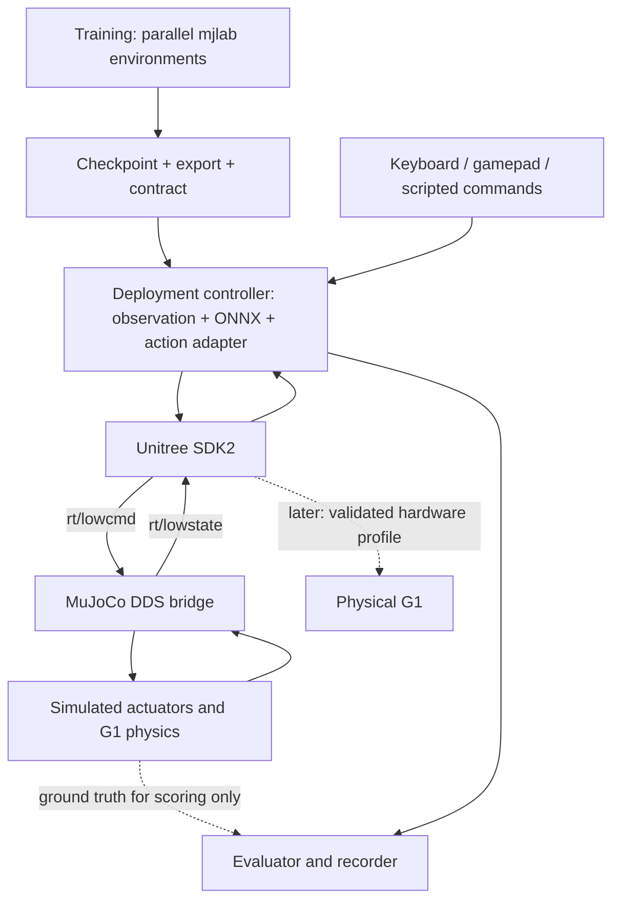

> ตำแหน่งโครงการปัจจุบัน: `unitree/g1_sim2sim/` สร้าง scaffold แล้ว แต่ runtime/training ยังไม่ได้ implement; โครงสร้างในแผนนี้เป็นข้อเสนอเดิม ให้ดู [README](../README.md) สำหรับ layout ปัจจุบัน

# แนวทาง implement G1: Train → Sim-to-Sim ผ่าน Unitree SDK → เตรียม Sim-to-Real

เอกสารนี้เป็นแผนพัฒนาโดยอ้างอิง source code ใน `/home/luke/nvidia` ที่ตรวจเมื่อ 19 ตุลาคม 2026 ยังไม่ได้สร้างระบบตามแผนหรือทดสอบกับหุ่นจริง ค่าตัวเลขที่ระบุว่า “เสนอ” เป็นจุดเริ่มออกแบบ ไม่ใช่ค่าที่รับรองแล้ว

## 1. เป้าหมายและขอบเขต

ต้องการฝึก policy ให้ G1 ยืนและเดิน จากนั้นนำ policy ออกจาก training environment ไปทำงานในโปรแกรม controller อีก process หนึ่ง โดยรับสถานะและส่งคำสั่งมอเตอร์ผ่าน **Unitree SDK2 / DDS จริง** ไปยัง G1 ใน MuJoCo simulator

สิ่งที่จะได้คือเส้นทางควบคุมที่ใกล้ deployment จริง: policy, preprocessing, joint mapping, PD targets, DDS messages, timing, state machine และ fault handling ถูกทดสอบร่วมกัน ก่อนเปลี่ยนปลายทางเป็นหุ่นจริง

**Sim-to-sim ผ่านเป็นหลักฐานว่าระบบเชื่อมต่อและควบคุมทำงานในเงื่อนไขที่ทดสอบ ไม่ใช่หลักประกันว่าเปลี่ยน network interface แล้วใช้กับหุ่นจริงได้ทันที** ยังมีช่องว่างเรื่องมอเตอร์ ความหน่วง sensor calibration น้ำหนัก แรงเสียดทาน firmware และระบบป้องกันของหุ่น

ขอบเขตแรก:

- G1 แบบ 29 DoF เป็นสมมติฐานตั้งต้นตาม controller ใน repo; ต้องยืนยันรุ่นจริงก่อนทำ hardware profile
- เริ่มจากทรงตัวจากท่ายืน ไม่ใช่ลุกจากพื้น
- เดินตามคำสั่ง `(vx, vy, wz)` บนพื้นเรียบ ไม่รวม navigation และ obstacle avoidance
- Train ด้วย simulator โดยตรงเพื่อให้เก็บประสบการณ์จำนวนมากได้เร็ว
- ทดสอบ deployment แบบแยก process ผ่าน SDK/DDS โดย controller ไม่อ่าน memory ของ simulator
- ใช้ pretrained policy ของต้นทางเพื่อเช็ค plumbing ได้ แต่ผลหลักต้องมาจาก policy ที่เราเทรนเอง

## 2. ต้องแยกความหมายของ “Unitree API จริง” ให้ชัดเจน

| เส้นทาง | ใครสร้างคำสั่งข้อต่อ | เหมาะกับอะไร |
| --- | --- | --- |
| High-level เช่น `LocoClient.Move()` | ตัวควบคุม locomotion ของ Unitree | เรียกพฤติกรรมเดินสำเร็จรูปบนระบบที่มีบริการนั้น |
| Low-level `LowCmd_` / `LowState_` ผ่าน SDK2 | controller และ policy ของเรา | ทดสอบและ deploy policy ที่เราเทรนเอง |

แผนหลักใช้ low-level API ของ Unitree จริง ได้แก่ message types, serialization และ DDS transport ของ SDK ไม่ใช่เขียน network protocol เลียนแบบเอง ส่วน simulator ทำหน้าที่แทน plant และส่ง sensor state กลับมา

`unitree_mujoco` มี bridge สำหรับ low-level motor commands ไม่ควรถือว่าเรียก high-level `Move()` แล้ว simulator จะเดินได้โดยอัตโนมัติ หากต้องการ API แบบ `move(vx, vy, wz)` ให้สร้าง command interface ของโครงการเหนือ policy อีกชั้น และระบุว่าเป็น API ของเรา การทำ service ให้เข้ากันกับ high-level RPC ของ Unitree ต้องเป็นงาน compatibility แยกต่างหาก [อ้างอิง Unitree MuJoCo](https://github.com/unitreerobotics/unitree_mujoco) และ [G1 locomotion API](https://github.com/unitreerobotics/unitree_sdk2_python/blob/master/unitree_sdk2py/g1/loco/g1_loco_api.py)

## 3. สถาปัตยกรรมที่ต้องการ



แยกอย่างน้อย 3 process:

1. **Simulator:** physics, actuator model, sensors และ DDS bridge
2. **Controller:** state validation, observation, inference, action mapping และส่ง LowCmd
3. **Evaluator:** บันทึกสถานะและวัดคุณภาพ โดยอ่าน ground truth ของ sim ได้เฉพาะเพื่อให้คะแนน

Ground truth สำหรับ evaluator ต้องไม่ย้อนเข้ามาช่วย actor โดยไม่ประกาศไว้ใน policy contract

การ train ไม่ต้องวิ่ง DDS ทุก environment: ใช้ direct batched simulation แล้วจำลอง noise/delay ที่ต้องการใน environment การต่อ DDS เป็น deployment integration test ไม่ใช่ข้อกำหนดว่าทุก PPO rollout ต้องส่ง network packet

## 4. สิ่งที่มีอยู่แล้วและจุดที่ต้องระวังใน workspace

| ส่วน | ตำแหน่ง | ข้อเท็จจริงจาก source ที่ตรวจ |
| --- | --- | --- |
| Standalone training | `mjlab/` | package configuration ระบุ 1.6.0; คู่มือก่อนหน้าใช้เส้นทางนี้ |
| Unitree training + deployment | `unitree/unitree_rl_mjlab/` | `setup.py` pin mjlab 1.2.0 และ mujoco-warp 3.5.0 |
| Integrated simulator | `unitree/unitree_rl_mjlab/simulate/` | config ใช้ G1, DDS domain 0, interface `lo` |
| G1 controller | `unitree/unitree_rl_mjlab/deploy/robots/g1/` | C++, ONNX Runtime, FSM และ Unitree DDS |
| Standalone simulator | `unitree/unitree_mujoco/` | Python config ที่ตรวจ default เป็น Go2, domain 1, `lo` ต้องเปลี่ยนก่อนใช้ G1 |
| Python SDK | `unitree/unitree_sdk2_python/` | มีตัวอย่าง G1 low-level และการคำนวณ CRC |

ประเด็นที่ต้องแก้หรือยืนยันก่อนต่อระบบ:

1. G1 C++ controller เรียก DDS `Init(0, network)` โดย domain เป็น 0 ใน source ไม่ใช่ option ที่เปลี่ยนได้แล้ว
2. Integrated simulator ใช้ domain 0 จึงเข้าคู่กัน แต่ standalone Python simulator ใช้ domain 1 จึงจับคู่กันไม่ได้ทันที
3. Controller G1-29DoF ตรวจ `mode_machine` และตั้งเป็น 5 ใน checkout นี้ อย่านำเลขนี้ไปใช้กับทุกรุ่นโดยไม่ตรวจ low state/เอกสารรุ่นนั้น
4. Policy เดิมของ standalone mjlab ใช้ `base_lin_vel` ใน actor ขณะที่ Unitree deployment profile ที่ตรวจใช้ IMU, joints, commands และ gait phase โดยไม่มี base linear velocity ใน actor
5. รูปแบบ observation ต่างกัน จึงไม่สามารถคัดลอก `.onnx` ข้ามสองเส้นทางแล้วคาดว่าจะทำงานได้
6. Python bridge ที่ตรวจตั้งชื่อ flag `have_imu` / `have_frame_sensor` แต่มีบางส่วนใช้ชื่อท้าย `_`; ต้องตรวจการเริ่มค่าและเงื่อนไข sensor ให้ครบหากเลือกเส้นทางนี้
7. Python bridge คำนวณ PD torque ใน callback รับคำสั่ง ส่วน integrated C++ bridge คำนวณใน recurrent loop ความถี่/พฤติกรรมเมื่อ packet หายจึงอาจต่างกัน
8. การมี gain/torque ใน message ไม่ยืนยันว่า simulator บังคับ limits หรือรับมือ timeout แบบ firmware จริง ต้องทดสอบและเพิ่มให้ชัดเจน

## 5. เลือกฐานพัฒนา

### เส้นทางหลักสำหรับเป้าหมายนี้

ใช้ `unitree_rl_mjlab` เป็น baseline สำหรับ train/export/controller/integrated simulator เพราะมีองค์ประกอบ deployment จับคู่กันอยู่แล้ว แยก environment จาก standalone `mjlab` และเก็บ custom tasks ของเราแยกจากต้นทาง

ต่างจาก [คู่มือ training ก่อนหน้า](reference/training_from_scratch_mjlab.md) ที่เน้นเริ่มเรียน RL ด้วย standalone mjlab: สำหรับเป้าหมาย SDK deployment ให้จัด observation/action contract ก่อนเริ่มเทรนครั้งใหญ่

### ถ้าต้องการใช้ policy จาก standalone mjlab ต่อ

ทำได้ แต่ต้อง implement preprocessing และ action adapter ให้ตรงกับ policy นั้น พร้อมจัดการแหล่ง `base_lin_vel`:

- ทางเลือก A: ตัด base linear velocity ออกจาก actor แล้วเทรนใหม่ โดยเก็บ ground truth ไว้ใน critic/reward ได้
- ทางเลือก B: เพิ่ม state estimator ที่ใช้ข้อมูลที่มีจริง แล้วใช้ estimator เดียวกันใน training/evaluation/deployment

ไม่ควรใส่ความเร็วจาก ground truth ของ MuJoCo ให้ actor แล้วนับว่าเป็นผลทดสอบความพร้อม sim-to-real

## 6. โครงสร้างโครงการที่เสนอ

โครงสร้างนี้ยังไม่ได้สร้าง ชื่อไฟล์และ CLI ของ custom tools ด้านล่างเป็นสิ่งที่จะ implement ไม่ใช่คำสั่งที่มีพร้อมแล้ว

```text
unitree/g1_sim2sim/
├── README.md
├── configs/
│   ├── robot_g1_29dof.yaml
│   ├── transport_sim.yaml
│   ├── transport_real.template.yaml
│   ├── timing.yaml
│   ├── safety.yaml
│   └── scenarios/
│       ├── stand.yaml
│       ├── walk_forward.yaml
│       ├── turn_stop.yaml
│       └── faults.yaml
├── training/
│   ├── tasks/stand.py
│   ├── tasks/walk.py
│   ├── observations.py
│   ├── randomization.py
│   └── export_bundle.py
├── controller/
│   ├── main.cpp
│   ├── unitree_transport.cpp
│   ├── state_buffer.cpp
│   ├── observation_builder.cpp
│   ├── policy_runner.cpp
│   ├── action_adapter.cpp
│   ├── command_source.cpp
│   ├── watchdog.cpp
│   └── fsm.cpp
├── simulator/
│   ├── launcher.py
│   ├── bridge_config.yaml
│   └── fault_injection.py
├── tools/
│   ├── inspect_model.py
│   ├── record_dds.py
│   ├── compare_observations.py
│   ├── compare_policy_outputs.py
│   ├── run_scenario.py
│   └── summarize_run.py
├── tests/
│   ├── fixtures/
│   ├── test_joint_mapping.py
│   ├── test_observation_parity.py
│   ├── test_action_parity.py
│   ├── test_message_contract.py
│   └── test_fault_transitions.py
├── artifacts/<policy_id>/
└── results/<run_id>/
```

ใช้ C++ controller เดิมเป็นฐานเพื่อลดการเปลี่ยน runtime ก่อน sim-to-real ใช้ Python สำหรับ training, analysis และ test tooling หากเริ่ม prototype controller ด้วย Python ต้องเก็บ golden fixtures สำหรับเทียบเมื่อ port ไป C++

## 7. Phase 0 — ล็อกเวอร์ชันและ robot contract

รายการ implement:

- [ ] บันทึก commit ของ training repo, simulator, SDK และ controller
- [ ] แยก Python environment ของ `unitree_rl_mjlab` ตาม setup ของ repo
- [ ] บันทึก Python, CUDA, Torch, MuJoCo, Warp, ONNX Runtime, CycloneDDS และ compiler versions
- [ ] ยืนยัน 29 หรือ 23 DoF, อุปกรณ์มือ, payload และ geometry ที่เลือก
- [ ] สร้าง `robot_g1_29dof.yaml` เป็นแหล่งข้อมูล joint contract
- [ ] สร้างเครื่องมือ dump joint names, actuator names, sensor names, limits และ motor IDs
- [ ] ตรวจ joint mapping แบบ bijection สำหรับข้อต่อที่ควบคุม ไม่มี ID ซ้ำหรือหลุดช่วง
- [ ] กำหนดพฤติกรรมของ message slots ที่ไม่ได้ใช้งานอย่างชัดเจน ไม่สรุปจากขนาด array ว่ามี motor จริงทุก slot

ข้อมูลต่อข้อต่อที่ต้องมี:

| Field | ความหมาย |
| --- | --- |
| `joint_name` | ชื่อหลักของโครงการ |
| `training_index` | ตำแหน่ง action/observation ใน training |
| `sdk_motor_id` | motor index ใน Unitree message |
| `sim_joint_name`, `sim_actuator_name` | ชื่อที่ resolve ใน MuJoCo |
| `sign`, `zero_offset` | การแปลงทิศและตำแหน่งศูนย์ |
| `default_q`, `action_scale` | การแปลง policy action เป็น target |
| `kp`, `kd` | gains ที่ใช้ในโหมด policy |
| `q_limits`, `dq_limits`, `tau_limits` | ขอบเขตที่ยืนยันจาก model/hardware profile |

**เกณฑ์ผ่าน:** สร้างรายงาน mapping ได้ และ unit test round-trip แปลง training order → motor order → training order คืนค่าเดิม โดยไม่สมมติว่า index ทุกระบบตรงกัน

## 8. Phase 1 — รัน baseline simulator/controller ผ่าน DDS

เริ่มจาก integrated simulator ของ `unitree_rl_mjlab` เพื่อให้ robot model, policy sample และ controller ใกล้เคียงกันที่สุด

คำสั่ง build อ้างอิง layout ที่มีอยู่ โดยต้องติดตั้ง dependencies ตาม `unitree/unitree_rl_mjlab/doc/setup_en.md` และ README ก่อน:

```bash
cd /home/luke/nvidia/unitree/unitree_rl_mjlab
cmake -S simulate -B simulate/build
cmake --build simulate/build -j2
cmake -S deploy/robots/g1 -B deploy/robots/g1/build
cmake --build deploy/robots/g1/build -j2
```

เปิด simulator จาก repo root เพื่อให้ relative scene path ตรง:

```bash
cd /home/luke/nvidia/unitree/unitree_rl_mjlab
./simulate/build/unitree_mujoco
```

อีก terminal:

```bash
cd /home/luke/nvidia/unitree/unitree_rl_mjlab/deploy/robots/g1/build
./g1_ctrl --network=lo
```

คู่ baseline นี้ใช้ domain 0 ตาม source/config ที่ตรวจ ต้องมี gamepad ตาม flow ต้นทาง หรือ implement command source สำหรับ FSM ก่อนทดแทน ห้ามถือว่าแค่ปิด `use_joystick` แล้ว keyboard จะสั่งทุก state ได้ทันที

รายการ implement เพิ่ม:

- [ ] เริ่มด้วย DDS subscriber อย่างเดียว: ดู q/dq/IMU, message rate และ state age
- [ ] ยืนยัน message type สำหรับ G1 เป็น `unitree_hg` ไม่ใช่ `unitree_go`
- [ ] ยืนยัน `rt/lowstate` และ `rt/lowcmd` อยู่ domain/interface เดียวกัน
- [ ] เพิ่ม option `domain_id` ให้ controller แทนค่าคงที่ แล้วใช้ sim profile domain 1 + `lo` หลังทดสอบทั้งสองฝั่งแล้ว
- [ ] ตรวจ interface ที่ DDS bind จริง; domain แยกเป็นการแบ่ง traffic ไม่ใช่ระบบ authentication
- [ ] เพิ่ม startup summary: robot variant, domain, interface, model hash, policy hash และ control periods
- [ ] ใช้ publisher ควบคุมเพียงตัวเดียว และไม่รันตัวอย่าง low-level อื่นพร้อมกัน
- [ ] ทดสอบเปลี่ยน Passive → FixStand → Velocity ตาม FSM ของต้นทางใน sim

**เกณฑ์ผ่าน:** baseline เดิมทำงานผ่าน DDS, รับ state ต่อเนื่อง, ส่งคำสั่งเห็นผลใน sim และหยุด/เปลี่ยนโหมดได้ตามที่ระบุ บันทึกว่าใช้ pretrained baseline ไม่ใช่ผลจาก policy ของเรา

## 9. Phase 2 — ออกแบบ policy contract ก่อน train

สร้าง `policy_contract.yaml` และ schema validator ครอบคลุม:

- [ ] Actor observation names ตามลำดับจริง พร้อม dimensions, dtype, frame, units
- [ ] Scaling, clipping, normalization mean/variance และตำแหน่งที่ทำ normalization
- [ ] History length, การเรียง time/joint axis และ reset history behavior
- [ ] แหล่งข้อมูลแต่ละ observation: DDS, command generator หรือ estimator
- [ ] Command units/ranges และกฎเมื่อ command หมดอายุ
- [ ] Action dimensions, ordering, clipping, scaling และ default pose
- [ ] Policy/control timestep, gait phase definition และ phase reset
- [ ] Recurrent hidden state หากมี และกฎ reset เมื่อออกจาก policy mode
- [ ] Robot model hash, joint map hash, checkpoint ID และ ONNX input/output names

### Observation สำหรับเส้นทาง hardware-compatible

| Observation | แหล่ง deploy | สิ่งที่ต้องตรวจ |
| --- | --- | --- |
| Angular velocity | IMU gyroscope ใน LowState | sensor frame, body frame, หน่วย rad/s |
| Projected gravity | Quaternion + world gravity direction | ลำดับ wxyz/xyzw และทิศ rotation |
| Joint position relative | `motor_state.q` ลบ reference | motor map, zero offset, radians |
| Joint velocity | `motor_state.dq` | frame/sign, filtering และ rad/s |
| Velocity command | command source ของเรา | ลำดับ vx, vy, wz และ body frame |
| Previous action | controller internal state | raw/clipped/processed ต้องตรงกับ training |
| Gait phase หาก policy ใช้ | phase generator | period และ sin/cos ordering |
| Base linear velocity หาก policy ใช้ | estimator ที่ประกาศไว้ | ห้ามแทนด้วย sim truth แล้วอ้าง hardware parity |

Deploy profile G1 velocity ใน repo ที่ตรวจมี gyro 3 + gravity 3 + command 3 + phase 2 + joints 29 + joint velocity 29 + previous action 29 รวม **98 ค่า** เป็นตัวอย่างของ profile นั้น ไม่ใช่ค่าคงที่สำหรับ policy G1 ทุกตัว ต้องอ่าน ONNX และ contract ของ artifact ที่โหลดจริง

**เกณฑ์ผ่าน:** ทุก input ของ actor มีแหล่งข้อมูล deploy ระบุครบ หากไม่มีต้องแก้ observation/estimator ก่อน train

## 10. Phase 3 — Train stand/walk โดยคิดถึง deployment

- [ ] สร้าง custom task แยกจาก upstream พร้อม experiment names ของเรา
- [ ] เริ่ม stand ด้วย zero velocity commands และ upright reset
- [ ] เริ่ม walk ด้วย forward command ช่วงแคบและมี zero command บางส่วน
- [ ] ใช้ actor observations ตาม contract; critic/reward ใช้ privileged information ได้
- [ ] ปิด curriculum ที่ขยาย command range โดยไม่ตั้งใจใน baseline
- [ ] ตั้ง PD gains, action scale และ limits ให้ตรง deployment profile
- [ ] ตรวจว่า actuator model ใน training เป็นชนิดเดียวกับที่ bridge คำนวณ หรือบันทึกความต่างที่จะทดสอบ
- [ ] เก็บ baseline ที่ไม่มี noise ก่อน แล้วเพิ่ม noise/delay/randomization ทีละกลุ่ม
- [ ] บันทึก seed อย่างน้อย 3 ค่าเมื่อเปรียบเทียบวิธีที่ได้ผล
- [ ] ประเมิน direct play ก่อน export ทุกครั้ง

การ train baseline ของต้นทางใช้ task `Unitree-G1-Flat` ไม่ใช่ `Mjlab-Velocity-Flat-Unitree-G1` จาก standalone checkout สำหรับ custom task ต้องเพิ่ม registration/import ก่อนเรียก training script อย่าใช้ wrapper จากคู่มือ 1.6.0 กับฐาน 1.2.0 โดยไม่ตรวจ API

**เกณฑ์ผ่าน:** policy ของเรายืน/เดินใน training simulator ได้ มี checkpoint, source snapshot และ metrics พร้อมไป export

## 11. Phase 4 — Export เป็น deployment bundle

โครงสร้าง artifact ที่ต้องผลิต:

```text
artifacts/g1_walk_<id>/
├── exported/policy.onnx
├── exported/policy.onnx.data   # ถ้า exporter ใช้ external weights
├── params/deploy.yaml
├── policy_contract.yaml
├── joint_map.yaml
├── manifest.json
└── golden/
    ├── raw_states.npz
    ├── observations.npz
    └── actions.npz
```

- [ ] Export deterministic actor พร้อม normalization ตาม training
- [ ] ตรวจ normalization อยู่ใน graph หรือ controller เพื่อป้องกันทำซ้ำ/ไม่ได้ทำ
- [ ] Generate `deploy.yaml` จาก config ของ run นั้น ไม่คัดลอกค่าของ pretrained policy มาทั้งไฟล์
- [ ] Copy external ONNX data files ให้ครบเมื่อมี
- [ ] เก็บ input/output schema, checksums และ version manifest
- [ ] ใช้ artifact directory ระบุ version ชัดเจน ไม่เลือกโฟลเดอร์ล่าสุดโดยอาศัยชื่อเรียงลำดับ
- [ ] เก็บ export ต่อ checkpoint: runner ต้นทางที่ตรวจเขียน `policy.onnx` ชื่อเดิมเมื่อ save จึงต้องป้องกันสับสนว่าไฟล์นั้นมาจาก checkpoint ใด

### Parity tests ก่อนปล่อยหุ่นใน sim

1. เก็บ raw sensor state, commands และ internal state จาก training ในหลายสถานการณ์
2. สร้าง observation ด้วย Python training path และ deployment builder แล้วเทียบทีละ term
3. ป้อน observation เดียวกันเข้า PyTorch deterministic inference และ ONNX Runtime
4. เทียบ raw actions, clipped actions, target q และ motor order
5. ทดสอบ reset, zero command, command transition, near-limit และ quaternion rotations ที่รู้คำตอบ

เสนอใช้ `atol=1e-5, rtol=1e-4` เป็นค่าเริ่มตรวจ float32 parity แล้วปรับตาม numerical backend พร้อมบันทึกเหตุผล ต้องตรวจ max absolute error ใกล้ศูนย์ด้วย ไม่ใช้ relative error อย่างเดียว

**เกณฑ์ผ่าน:** observation/action parity ผ่านทุก fixture ไม่มี unexplained mismatch และ artifact โหลดได้โดยไม่ใช้ training framework

## 12. Phase 5 — Implement controller runtime

### 12.1 Transport และ state buffer

- [ ] SDK subscriber อ่าน LowState แล้ว copy เป็น immutable snapshot พร้อม local monotonic receive timestamp
- [ ] แยก callback thread ออกจาก inference/control thread
- [ ] ตรวจ finite values, quaternion norm, joint count, robot variant และ state freshness
- [ ] ตรวจ tick/sequence ถ้ามีและเชื่อถือได้ใน profile นั้น; อย่าสมมติว่า timestamp ทุก message ใช้ clock เดียวกัน
- [ ] Latest-state semantics: ไม่ไล่ประมวลผล packet เก่าทีละรายการจนเกิด backlog
- [ ] ใช้ snapshot เดียวกันสำหรับ observation รอบหนึ่ง ป้องกัน q และ IMU มาจากคนละ update

### 12.2 Inference loop

- [ ] ONNX session warm-up ก่อนเข้า policy state
- [ ] Preallocate tensors/buffers ลด allocation ระหว่าง control
- [ ] เริ่ม 50 Hz ตาม `step_dt=0.02` ของ G1 deploy profile ที่ตรวจ
- [ ] เก็บ inference duration, loop duration, missed deadlines และ state age
- [ ] Publish latest target ผ่าน buffer ที่มี synchronization
- [ ] เมื่อเลย deadline ไม่ยิง catch-up inference รัวเพื่อชดเชยเวลาโดยไม่มีขอบเขต

### 12.3 Action adapter และ LowCmd

คำนวณตาม contract:

```text
action = validate_and_clip(policy_output)
q_target_training_order = default_q + action_scale * action
q_target_motor_order = map_joints(q_target_training_order)
```

คำสั่งต่อ motor มี `q`, `dq`, `kp`, `kd`, `tau` ตามโหมดที่เลือก สูตร PD ที่ bridge ต้นทางใช้คือ:

```text
tau_applied = tau_ff + kp * (q_target - q) + kd * (dq_target - dq)
```

- [ ] Mapping ของ gains, limits และ reference pose ต้องใช้ joint map เดียวกับ action ไม่ใช่ map เฉพาะ q
- [ ] ตรวจและ clip target ตาม joint limits และกำหนด rate limit ที่ตรงกับการทดสอบ
- [ ] ตั้ง `dq_target`/feedforward torque ให้ตรง training ไม่สมมติค่าเองระหว่าง deploy
- [ ] ตรวจ `mode_pr` และ ankle coordinate convention ว่าตรง PR/AB mode ของ profile
- [ ] ตรวจ `mode_machine` จากสถานะและ profile ไม่ bypass mismatch เพื่อให้โปรแกรมรันต่อ
- [ ] ใช้ CRC utility ของ SDK หรือ publisher wrapper ที่ทำ CRC อยู่แล้ว โดยตรวจ source ให้แน่ใจ
- [ ] เติม field ที่จำเป็นและ unused slots ตาม schema ที่ยืนยัน

ตัวอย่างทางการ G1 แสดงการใช้ low-level message และ CRC ให้ใช้เป็นข้อมูลอ้างอิง field semantics ไม่ใช่รัน motion example บนหุ่นเพื่อเช็ค network [Unitree G1 low-level example](https://github.com/unitreerobotics/unitree_sdk2_python/blob/master/example/g1/low_level/g1_low_level_example.py)

### 12.4 State machine

```text
DISCONNECTED → STATE_READY → PASSIVE → FIX_STAND → POLICY_STAND → POLICY_WALK
Any active state → FAULT
FAULT → recovery checks + explicit re-arm → PASSIVE
```

- [ ] เข้า active state ได้เมื่อ state สด, artifact valid และ robot contract ตรง
- [ ] FixStand interpolate จาก pose ปัจจุบัน ไม่กระโดดเข้าท่ามาตรฐานทันที
- [ ] ถ้าใช้ stand/walk คนละ policy ต้องตรวจ continuity ของ target และ reset history/phase ให้ถูกต้อง
- [ ] ทางเลือกที่ง่ายกว่าเมื่อเดินได้แล้ว: policy เดียวรับ zero/nonzero command
- [ ] `FAULT` latch สาเหตุไว้ ไม่ auto-resume เมื่อ packet กลับมา
- [ ] แยก command timeout จาก low-state timeout และ policy failure

การลด command เป็นศูนย์เหมาะกับ command-source timeout เมื่อ policy/state ยังปกติ แต่ใช้แก้ inference ที่ให้ NaN ไม่ได้ โหมด damping ก็ไม่ได้รับประกันว่าหุ่นจะทรงตัว ต้องกำหนด fallback และทดสอบผลล้ม/โหลดของแต่ละ state ใน sim

## 13. Phase 6 — ทำ simulator bridge ให้ใกล้เส้นทางจริง

- [ ] Callback DDS รับและเก็บ command เท่านั้น
- [ ] Physics loop อ่าน latest command snapshot แล้วคำนวณ actuator torque ทุก physics step
- [ ] อย่าเพิ่ม MuJoCo position actuator ซ้อน PD ที่คำนวณเองโดยไม่ตั้งใจ
- [ ] Resolve joints/sensors ด้วยชื่อและตรวจ dimension ไม่พึ่ง sensor offsets ที่สมมติไว้เงียบ ๆ
- [ ] Publish LowState จาก state snapshot หลัง physics step ที่กำหนดไว้
- [ ] ตรวจ quaternion, angular velocity และ accelerometer frames รวมถึง gravity convention
- [ ] ใช้ locks หรือ double buffers ให้การอ่าน/เขียน `mjData` ไม่แข่งกันระหว่าง threads
- [ ] Implement command watchdog ใน simulator ด้วย: ถ้า controller ถูก kill จะไม่มีใครส่ง fallback จากฝั่ง controller ได้
- [ ] ตรวจ CRC/mode/limits ใน bridge หรือกำหนด test double สำหรับตรวจ message ก่อน actuator
- [ ] ตรวจ torque saturation, velocity limits, gear/armature/damping และแรงเสียดทานจาก model จริง
- [ ] แยก fault injection ของ state path และ command path
- [ ] แยก ground-truth telemetry ของ evaluator ออกจาก LowState ที่ actor ใช้

หาก bridge ที่ใช้อยู่ไม่ตรวจ CRC/mode/timeout ต้องบันทึกว่าเป็นข้อจำกัดของผล sim-to-sim การที่หุ่นใน sim ขยับได้ไม่ได้พิสูจน์ว่าหุ่นจริงจะรับ packet เดียวกัน

## 14. Phase 7 — Timing, latency และ clock

| Loop | ข้อมูลจาก local baseline / เป้าหมาย |
| --- | --- |
| Training physics | velocity config ที่ตรวจใช้ 0.005 s |
| Policy inference | deploy profile ใช้ 0.02 s หรือ 50 Hz |
| C++ FSM | source กำหนด 0.001 s |
| Integrated bridge loop | RecurrentThread ตั้ง 1000 microseconds |
| Actual DDS/physics cadence | ต้องวัด ไม่สรุปจาก loop period ว่าส่ง/รับทันจริงทุกครั้ง |

- [ ] ระบุ command publish period แยกจาก policy period
- [ ] ใช้ monotonic clock สำหรับ deadlines/watchdog ไม่ใช้เวลาปฏิทิน
- [ ] บันทึก sim time และ wall time แยก พร้อม real-time factor
- [ ] ทดสอบ wall-clock real-time สำหรับ deployment และ lockstep สำหรับ debugging เป็นคนละโหมด
- [ ] เมื่อ pause sim ให้ controller รับรู้ว่า state ไม่เดินหน้า แม้มี packet เก่าส่งซ้ำ
- [ ] เมื่อ reset sim ให้เริ่ม session ใหม่และ clear controller buffers/history/phase
- [ ] ทดสอบ slow simulation และ CPU overload โดยไม่ให้ clock mismatch ถูกนับเป็น policy failure โดยไม่มีข้อมูล

ตัวอย่าง budget เริ่มต้นสำหรับ sim: inference p99 ต่ำกว่า 10 ms ที่ policy period 20 ms; state stale timeout และ command timeout ให้กำหนดจาก nominal period + measured jitter + ผลทดสอบ fallback ไม่คัดลอกตัวเลขของ sim ไป hardware โดยตรง

## 15. Phase 8 — แผนทดสอบเป็นลำดับ

| Test | วิธี | หลักฐานที่ต้องเก็บ |
| --- | --- | --- |
| T00 Contract | ตรวจ schema, hashes, dimensions, map | validator report |
| T01 Read-only DDS | ไม่ส่ง motor command | state rates, age, frames |
| T02 Joint mapping | sim แขวน/ล็อกฐาน ขยับทีละ joint ด้วย target เล็ก | joint name/ID/sign ถูกต้อง |
| T03 PD behavior | step/sine target ขนาดเล็กใน sim | q target/actual, torque, saturation |
| T04 Export parity | fixed raw states และ observations | per-term/per-action errors |
| T05 FixStand | interpolate จากหลาย initial poses | peak target change, posture |
| T06 Policy stand | zero command, free base, ไม่มี support force | survival, drift, tilt |
| T07 Walk forward | speed ขั้นต่ำก่อน แล้วเพิ่มตาม train range | tracking error, falls, slip |
| T08 Stop/turn | ramp commands, หยุดหลังเดิน, turn ที่ฝึกแล้ว | stopping time, overshoot |
| T09 Faults | drop/delay state/command, kill controller, NaN | detection time และ FSM transitions |
| T10 Dynamics sweep | friction/mass/gains/delay หลายค่า | success map, failure cases |
| T11 Long run | scripted sequence ต่อเนื่อง | jitter, memory, stale events |

T02/T03 ใช้ support ได้เพื่อแยกตรวจ actuator แต่ **T06 เป็นต้นไปต้องปิด elastic band/การพยุงเมื่อวัดความสามารถยืนเดิน** ไม่เช่นนั้นจะประเมินความสามารถ policy สูงเกินจริง

เสนอชุด smoke scenarios:

1. ยืน 30 วินาที
2. เดินหน้า 0.2 m/s 10 วินาที → zero command 5 วินาที ทำซ้ำ 3 รอบ
3. เดินหน้า 0.4 m/s เฉพาะเมื่ออยู่ในช่วงที่ train
4. เลี้ยว ±0.2 rad/s หลัง train yaw commands แล้ว
5. ตรวจ command timeout ขณะเดิน โดย policy และ state ยังทำงาน
6. หยุด state publisher, หยุด command publisher และ kill controller เป็นคนละ test
7. Inject invalid quaternion และ NaN โดยยืนยันว่าไม่หลุดไป motor command

ทดสอบล้มแล้ว reset ผ่าน evaluation harness; deployment controller ไม่ควรตีความ state หลัง reset ว่าเป็น state ต่อเนื่องของ episode เดิม

## 16. Metrics และเกณฑ์ผ่าน

นิยาม metrics ก่อนเริ่ม tuning:

- Fall rate และสัดส่วน episode ที่จบด้วย timeout เทียบกับ termination
- Standing drift (m), RMS roll/pitch (rad), survival duration (s)
- Velocity tracking RMSE สำหรับ vx/vy และ yaw rate
- Stop response time และ residual motion หลัง zero command
- Target/actual joint error, torque peak และเวลาที่ saturate
- Foot slip จาก ground truth เฉพาะ evaluator
- State age, command age, inference p50/p95/p99 และ deadline misses
- Fault detection latency, fallback activation latency และ unwanted reactivation count
- Real-time factor, dropped/late samples และ simulator reset count

เสนอ milestone เริ่มต้นสำหรับ flat-ground nominal test:

- [ ] Parity tests ผ่านทุก fixture ก่อน closed-loop
- [ ] Standing สำเร็จอย่างน้อย 95/100 episodes ความยาว 30 s โดยไม่มีแรงพยุง
- [ ] Walking สำเร็จอย่างน้อย 90/100 episodes ตาม command sequence ที่กำหนด
- [ ] เสนอ tracking RMSE ≤ 0.1 m/s สำหรับ forward 0.2–0.4 m/s; ประเมินความเหมาะสมจาก baseline อีกครั้ง
- [ ] ไม่มี non-finite action/target หรือการส่ง target หลุด limit ที่กำหนด
- [ ] Fault ทุกประเภทเข้าสู่ state ที่กำหนดภายใน budget ที่ตั้งไว้ และไม่กลับมา active เอง
- [ ] Nominal wall-clock run รักษา real-time factor ใกล้ 1 พร้อม timing report

เกณฑ์เหล่านี้เป็น milestone ของโครงการ ไม่ใช่ certification สำหรับหุ่นจริง ต้องรายงานจำนวน trials, seeds, initial-state distribution และเงื่อนไข test ทุกครั้ง

## 17. ทำให้ sim-to-sim มีประโยชน์ต่อ sim-to-real จริง

ลำดับเพิ่มความสมจริง:

1. **Contract correctness:** joints, units, frames, normalization, actions และ modes ตรงกัน
2. **Timing correctness:** sampling, latency, jitter, stale state และ multi-rate loops
3. **Actuator fidelity:** PD, torque limits, motor dynamics, delay, friction และ backlash ที่มีข้อมูลรองรับ
4. **Sensor fidelity:** bias/noise/filter/delay และ estimator เหมือน deployment
5. **Dynamics variation:** payload, inertia, center of mass, ground friction และ contact parameters
6. **Fault behavior:** lost commands, process crash, pause/reset และ invalid data

Randomization ranges ต้องเริ่มจากค่าที่มีเหตุผลและขยายตามข้อมูล ไม่สุ่มทุกอย่างกว้างมากพร้อมกันจนแยกสาเหตุไม่ได้ เก็บค่าจริงที่ sampled ต่อ episode เพื่อย้อนวิเคราะห์ได้

MuJoCo Warp training → MuJoCo standalone deployment มีประโยชน์มากด้าน runtime/transport parity แต่ยังเป็น physics ตระกูลเดียวกัน จึงอาจมีความคลาดเคลื่อนร่วมกัน หลังผ่าน baseline ให้ใช้ model variants หรือ simulator ที่ต่างออกไปเป็น stress test เพิ่ม โดยไม่เปลี่ยนหลายอย่างพร้อมกัน

การเทียบ trajectory แบบ exact ระยะยาวไม่เหมาะกับระบบ contact ที่ไวต่อความต่างเล็กน้อย ใช้ exact/near-exact parity สำหรับ preprocessing/inference และใช้ statistical metrics สำหรับ closed-loop behavior

## 18. สิ่งที่ใช้ร่วมกับ sim-to-real และสิ่งที่ต้องปรับ

| ใช้ร่วมได้เมื่อ validate แล้ว | ต้องตั้งค่า/ตรวจใหม่เมื่อใช้หุ่นจริง |
| --- | --- |
| ONNX policy และ observation builder | sensor calibration และ estimator behavior |
| Joint/action adapters | รุ่น DoF, payload, zero offsets และ firmware |
| SDK transport implementation | interface, DDS profile และการครอบครอง control channel |
| FSM, logging และ watchdog logic | hardware timeout, protection และ stop procedure |
| Scenario command generator | พื้นที่ทดสอบและช่วงคำสั่งที่อนุญาต |
| Golden fixtures และ artifact validator | motor limits และ operating conditions |

ก่อน hardware trial:

- [ ] ยืนยันว่ารุ่นหุ่นและ firmware รองรับ low-level access ที่ต้องใช้
- [ ] ยืนยันไม่มี controller อื่นแย่งส่งคำสั่ง และปฏิบัติตาม procedure ของรุ่นนั้น
- [ ] อ่าน state อย่างเดียวก่อนและเทียบกับ robot contract
- [ ] ทำ calibration/system identification ตามขั้นตอนของผู้ผลิต
- [ ] ใช้ระบบพยุงและผู้ควบคุมที่เข้าถึงการหยุดได้สำหรับการทดสอบแรก
- [ ] เริ่มจาก actuator/mapping validation, FixStand, policy stand แล้วจึงเดินช้า
- [ ] เก็บ real logs แล้วเทียบกับ simulation เพื่อแก้ช่องว่างที่วัดพบ

ไฟล์นี้ไม่กำหนดคำสั่งเปิดโหมดบนหุ่นจริงแบบตายตัว เพราะยังไม่ทราบรุ่น/firmware ของเครื่องเป้าหมาย และไม่ได้เป็นขั้นตอนที่จะ execute ในงาน sim-to-sim นี้

## 19. Implement backlog ตามลำดับ dependency

| ID | งาน | ขึ้นกับ | Deliverable / เกณฑ์จบ |
| --- | --- | --- | --- |
| I01 | ล็อก repo/environment/robot variant | — | versions manifest และ robot profile |
| I02 | Build baseline simulator/controller | I01 | DDS baseline run log |
| I03 | เพิ่ม domain/interface config | I02 | sim profile แยก พร้อม connection tests |
| I04 | ทำ joint/sensor mapping inspector | I01 | validated joint map |
| I05 | กำหนด policy contract | I04 | schema + observation data sources |
| I06 | สร้าง custom stand/walk tasks | I05 | registered tasks และ smoke train |
| I07 | Train baseline จาก random weights | I06 | checkpoints + direct-play metrics |
| I08 | Export bundle + manifest | I07 | versioned ONNX/config bundle |
| I09 | ทำ observation/action parity tools | I05, I08 | golden fixtures + passing reports |
| I10 | ทำ transport buffer/runtime adapter | I03, I05 | read-only state validation |
| I11 | ทำ FSM/watchdog/command source | I10 | tested transitions และ timeout rules |
| I12 | เพิ่ม bridge timing/limits/watchdog | I02, I04 | actuator และ fault tests ผ่าน |
| I13 | เชื่อม policy closed-loop ผ่าน DDS | I09, I11, I12 | stand/walk sim-to-sim run |
| I14 | ทำ scenario harness และ metrics | I13 | repeatable batch reports |
| I15 | เพิ่ม noise/delay/dynamics tests | I14 | robustness matrix |
| I16 | Retrain ตาม failure ที่วัดพบ | I15 | candidate ใหม่ผ่าน regression |
| I17 | จัดทำ hardware readiness report | I16 | pass/fail/unknown และรายการงานจริงต่อไป |

เริ่ม implement รอบแรกที่ **I01–I05** เพื่อพิสูจน์ว่า SDK/DDS, simulator และ contract ตรงกันก่อนลงทุน train ยาว จากนั้นทำ I06–I09 เพื่อได้ policy ของเรา แล้วจึงทดสอบ closed-loop แบบครบเส้นทาง

## 20. Source ที่ควรอ่านขณะ implement

เส้นทางต่อไปนี้อ้างอิงจาก `/home/luke/nvidia`:

- `unitree/unitree_rl_mjlab/README.md`: build/train/play/deployment baseline
- `unitree/unitree_rl_mjlab/setup.py`: dependency pins
- `unitree/unitree_rl_mjlab/src/tasks/velocity/velocity_env_cfg.py`: actor/critic และ timing
- `unitree/unitree_rl_mjlab/src/tasks/velocity/rl/runner.py`: export ตอน save
- `unitree/unitree_rl_mjlab/deploy/robots/g1/main.cpp`: DDS initialization และ robot-mode check
- `unitree/unitree_rl_mjlab/deploy/robots/g1/config/policy/velocity/v0/params/deploy.yaml`: deploy contract ตัวอย่าง
- `unitree/unitree_rl_mjlab/deploy/include/unitree_articulation.h`: LowState → robot state
- `unitree/unitree_rl_mjlab/deploy/include/FSM/State_RLBase.h`: policy loop
- `unitree/unitree_rl_mjlab/deploy/include/FSM/CtrlFSM.h`: FSM loop
- `unitree/unitree_rl_mjlab/simulate/config.yaml`: simulation transport/model profile
- `unitree/unitree_rl_mjlab/simulate/src/unitree_sdk2_bridge.h`: command → torque และ state publication
- `unitree/unitree_mujoco/simulate_python/unitree_sdk2py_bridge.py`: Python bridge ทางเลือก
- `unitree/unitree_sdk2_python/example/g1/low_level/g1_low_level_example.py`: G1 message/CRC example

ก่อน upgrade ให้รัน contract/parity/fault regression ใหม่ และยึด source ของ revision ที่ใช้งานจริงเป็นหลักเมื่อ README หรือ online upstream ต่างจาก local checkout
