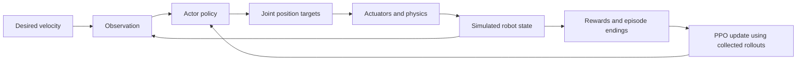

> เอกสารอ้างอิงเดิม: เก็บรายละเอียดและตัวอย่างเดิมไว้ ชื่อโครงการ `g1_training` และคำสั่งในไฟล์นี้ไม่ใช่ entry point ของโครงการใหม่ ให้เริ่มที่ [README](../../README.md) และ [แผนหลัก](../implementation_plan.md) ก่อนใช้งาน

# Build your own G1 standing and walking training project

This guide is a practical learning path for the workspace at `/home/luke/nvidia`. It is based on the local source inspected on 19 October 2026, including mjlab's `1.6.0` package configuration. Commands and examples target that checkout; check compatibility before updating it.

The goal is to understand reinforcement learning by creating your own tasks and training G1 policies from random initialization in simulation. You will reuse the G1 robot model, physics simulator, and PPO implementation, then write your own environment configuration and training entry points.

This document is a recipe. The project files shown below have not been created automatically, and GPU training has not been run to validate the recipe end to end.

## 1. Define what you want the robot to learn

Build these experiments in order:

1. **Stand:** start near an upright pose and learn to balance without moving away.
2. **Walk:** start upright and learn to follow a forward velocity command.
3. **Stand and walk:** use one policy that stands when the command is zero and walks when it is nonzero.
4. **Robustness:** gradually introduce disturbances, different friction, and wider command ranges.

Standing here means maintaining balance from an upright initial state. Getting up from lying on the floor is a different task with different resets, rewards, and termination rules.

“Walk by itself” initially means that the policy chooses joint actions without a person specifying each footstep. It still receives a desired velocity. Choosing destinations, avoiding obstacles, and navigation are later projects.

Train the standing and walking experiments independently from random weights first. This makes the learning process easier to compare. Transferring a standing checkpoint into walking is an optional later experiment.

## 2. Understand the learning loop



| Concept | Meaning in this project |
| --- | --- |
| Environment | The robot, ground, physics, observations, actions, rewards, and reset rules. |
| Observation | Numbers describing motion, orientation, joints, previous action, and the velocity command. |
| Action | Joint position offsets relative to a reference pose, scaled by the robot configuration. |
| Actor | A neural network that maps observations to actions. |
| Critic | A network that estimates future reward and helps train the actor. |
| Reward | A score encouraging useful behavior and discouraging undesirable behavior. |
| Episode | One attempt, ending after a timeout or failure. |
| Rollout | A batch of interaction steps collected before an update. |
| PPO | The algorithm that updates the networks using rollouts. |
| Checkpoint | Saved network and training state. |

The simulator does not supply examples of correct footsteps. Initially the actor explores through noisy actions. PPO increases the likelihood of actions associated with better estimated outcomes.

The current base task uses a physics timestep of `0.005` seconds and action decimation of `4`: physics runs at 200 Hz and the policy acts at 50 Hz. The configured actuators turn position targets into physical joint forces; the policy does not directly teleport joints.

The actor observes base linear/angular velocity, projected gravity, relative joint positions/velocities, previous actions, and commands. The critic receives additional information such as foot contacts. Inspect the actual configuration instead of hardcoding observation or action dimensions.

## 3. Choose one framework for this first project

Use the existing `/home/luke/nvidia/mjlab` checkout. It already contains the G1 robot and flat-ground velocity task, and your keyboard example uses it.

Create your learning code in `/home/luke/nvidia/unitree/g1_training`. Reuse mjlab's existing Python environment for this first tutorial, while keeping your source files separate.

Your earlier `unitree/G1_TRAINING_PLAN_TH.md` proposes using `unitree_rl_mjlab` and an isolated environment instead. That is a separate route. Its setup currently pins `mjlab==1.2.0`, while the standalone checkout declares `1.6.0`. Do not install that older dependency set into the environment used here.

## 4. Check the environment

Run these commands in a terminal:

```bash
cd /home/luke/nvidia/mjlab
nvidia-smi
uv --version
uv sync --locked
uv run python -c 'import torch; print("PyTorch:", torch.__version__); print("CUDA:", torch.cuda.is_available())'
uv run list-envs
```

You should see `Mjlab-Velocity-Flat-Unitree-G1` in the task list and `CUDA: True` for GPU training. Dependency installation may download large packages. If the lockfile and checkout disagree, resolve that mismatch before proceeding.

Start with 256 parallel environments. Increase to 512 or 1024 after checking memory and throughput. Environment counts and training time depend on the installed software and hardware; a fixed iteration count does not guarantee success.

Record the framework revision before experiments:

```bash
git -C /home/luke/nvidia/mjlab rev-parse HEAD
```

Save it in your experiment notes along with GPU, seed, configuration changes, and results.

## 5. Inspect the baseline before writing a task

```bash
cd /home/luke/nvidia/mjlab
uv run play Mjlab-Velocity-Flat-Unitree-G1 --agent zero --num-envs 1
uv run play Mjlab-Velocity-Flat-Unitree-G1 --agent random --num-envs 1
```

Run these one at a time and close the viewer between commands. If a native window is unavailable, try adding `--viewer viser` and use the address printed by the process.

Observe gravity, foot contacts, initial posture, and how random actions affect balance. Zero action means zero offset from the configured reference targets; it does not mean zero motor torque, and it is not a trained balancing controller.

Read these files in order, relative to `mjlab/`:

1. `src/mjlab/asset_zoo/robots/unitree_g1/g1_constants.py`: robot pose, actuator settings, and action scaling.
2. `src/mjlab/tasks/velocity/velocity_env_cfg.py`: shared environment components.
3. `src/mjlab/tasks/velocity/config/g1/env_cfgs.py`: G1-specific settings and flat terrain.
4. `src/mjlab/tasks/velocity/config/g1/rl_cfg.py`: actor, critic, and PPO configuration.
5. `src/mjlab/scripts/train.py`: environment creation, wrapping, checkpoint loading, and training.

## 6. Create the learning project

```bash
mkdir -p /home/luke/nvidia/unitree/g1_training/g1_training
mkdir -p /home/luke/nvidia/unitree/g1_training/docs
cd /home/luke/nvidia/unitree/g1_training
touch g1_training/__init__.py
```

Create the following files using the contents in the next sections:

```text
g1_training/
├── g1_training/
│   ├── __init__.py
│   ├── tasks.py
│   ├── train.py
│   └── play.py
├── docs/
│   └── experiments.md
└── logs/                 # Created by training, relative to the working directory
```

This uses Python's `-m` execution from the project root, so a packaging file is not needed yet. Always run the commands below from `/home/luke/nvidia/unitree/g1_training`. `uv run --project` selects mjlab's environment; it does not change your working directory.

### 6.1 Write `g1_training/tasks.py`

This creates two tasks with the same observation/action structure. For the first experiments it disables pushes, observation noise, and selected physical randomizations, while retaining the base reset behavior. It also disables the base curriculum so it cannot silently expand the command ranges.

```python
from mjlab.tasks.registry import register_mjlab_task
from mjlab.tasks.velocity.config.g1.env_cfgs import unitree_g1_flat_env_cfg
from mjlab.tasks.velocity.config.g1.rl_cfg import unitree_g1_ppo_runner_cfg
from mjlab.tasks.velocity.rl import VelocityOnPolicyRunner


def make_env(mode: str, play: bool = False):
    cfg = unitree_g1_flat_env_cfg(play=play)
    cfg.scene.num_envs = 256
    cfg.episode_length_s = 20.0
    cfg.curriculum = {}

    for name in ("push_robot", "foot_friction", "encoder_bias", "base_com"):
        cfg.events.pop(name, None)
    cfg.observations["actor"].enable_corruption = False

    command = cfg.commands["twist"]
    command.heading_command = False
    command.ranges.heading = None
    command.rel_heading_envs = 0.0
    command.rel_forward_envs = 0.0
    command.resampling_time_range = (3.0, 8.0)
    command.ranges.lin_vel_y = (0.0, 0.0)
    command.ranges.ang_vel_z = (0.0, 0.0)

    if mode == "stand":
        command.rel_standing_envs = 1.0
        command.ranges.lin_vel_x = (0.0, 0.0)
    elif mode == "walk":
        command.rel_standing_envs = 0.2
        command.ranges.lin_vel_x = (0.2, 0.6)
    else:
        raise ValueError(f"Unknown mode: {mode}")

    return cfg


def make_agent(mode: str):
    cfg = unitree_g1_ppo_runner_cfg()
    cfg.experiment_name = f"custom_g1_{mode}"
    cfg.logger = "tensorboard"
    cfg.max_iterations = 3000
    cfg.save_interval = 50
    cfg.seed = 42
    cfg.resume = False
    return cfg


for mode, task_id in (
    ("stand", "Study-G1-Stand-Flat"),
    ("walk", "Study-G1-Walk-Flat"),
):
    register_mjlab_task(
        task_id=task_id,
        env_cfg=make_env(mode),
        play_env_cfg=make_env(mode, play=True),
        rl_cfg=make_agent(mode),
        runner_cls=VelocityOnPolicyRunner,
    )
```

The walk task assigns zero commands to roughly 20% of sampled commands, allowing one policy to learn stopping as well as walking. This is a sampling probability, not a guarantee that exactly 20% of robots are standing at every step.

The standing task retains the base rewards: tracking zero velocity, staying upright, maintaining posture, and avoiding abrupt actions, joint limits, and undesirable contacts. It is a starting point to study, not a guaranteed optimal reward design.

### 6.2 Write `g1_training/train.py`

```python
import g1_training.tasks  # Register our tasks before parsing the CLI.
from mjlab.scripts.train import main

if __name__ == "__main__":
    main()
```

### 6.3 Write `g1_training/play.py`

```python
import g1_training.tasks
from mjlab.scripts.play import main

if __name__ == "__main__":
    main()
```

These wrappers reuse the local training and evaluation implementation. You own the task definitions and can inspect the framework loop without duplicating it immediately.

## 7. Verify your task registration and run a short training check

```bash
cd /home/luke/nvidia/unitree/g1_training
uv run --project /home/luke/nvidia/mjlab python -c 'import g1_training.tasks; from mjlab.tasks.registry import list_tasks; print([t for t in list_tasks() if t.startswith("Study-")])'
uv run --project /home/luke/nvidia/mjlab python -m g1_training.train Study-G1-Stand-Flat --help
uv run --project /home/luke/nvidia/mjlab python -m g1_training.play Study-G1-Stand-Flat --agent zero --num-envs 1
```

After closing the viewer, run a brief training check:

```bash
uv run --project /home/luke/nvidia/mjlab python -m g1_training.train Study-G1-Stand-Flat \
  --env.scene.num-envs 64 \
  --agent.max-iterations 10 \
  --agent.run-name smoke
```

Confirm that the task loads, rewards and losses remain finite, the process completes, and a run directory is written. Ten iterations verify the pipeline; they do not establish that the robot has learned to stand.

## 8. Train standing from random initialization

```bash
uv run --project /home/luke/nvidia/mjlab python -m g1_training.train Study-G1-Stand-Flat \
  --env.scene.num-envs 256 \
  --agent.max-iterations 3000 \
  --agent.run-name stand_baseline
```

The task has `resume=False`, so this starts a new policy rather than continuing the smoke run. Use 3000 iterations as an initial experiment budget, then decide whether to continue based on behavior and metrics.

In a second terminal:

```bash
cd /home/luke/nvidia/unitree/g1_training
uv run --project /home/luke/nvidia/mjlab tensorboard --logdir logs/rsl_rl
```

Open the address printed by TensorBoard. Inspect total reward, reward components, episode length, velocity errors, and losses. Exact tag names are determined by the installed runner.

Standing should show longer episodes, low translation and yaw drift, and limited oscillation. High reward alone is not proof of good balance: inspect whether the policy exploits posture or contact behavior.

## 9. Evaluate a specific checkpoint

Checkpoints are written under:

```text
logs/rsl_rl/custom_g1_stand/<timestamp>_stand_baseline/
├── model_<iteration>.pt
├── params/
└── events.out.tfevents...
```

List available checkpoints:

```bash
find logs/rsl_rl/custom_g1_stand -name 'model_*.pt' -print
```

Replace the example path below with an actual file from the selected run:

```bash
uv run --project /home/luke/nvidia/mjlab python -m g1_training.play Study-G1-Stand-Flat \
  --checkpoint-file logs/rsl_rl/custom_g1_stand/REPLACE_WITH_RUN/model_2999.pt \
  --num-envs 4
```

Compare early, middle, and late checkpoints. Watch for resets: a robot repeatedly falling and resetting can look superficially stable in a busy scene.

Suggested learning milestone: at least 90% of 100 evaluation episodes reach the 20-second timeout without falling, with little drift. This is a proposed target, not an achieved result. For a formal measurement, add an evaluation script that counts failure terminations separately from timeouts and records episode duration and displacement. The viewer alone does not calculate this success rate.

## 10. Train walking from random initialization

```bash
uv run --project /home/luke/nvidia/mjlab python -m g1_training.train Study-G1-Walk-Flat \
  --env.scene.num-envs 256 \
  --agent.max-iterations 3000 \
  --agent.run-name walk_baseline
```

This starts an independent policy. Walking does not require first loading a standing policy: the shared rewards teach balance and motion together.

Evaluate it using the walk task and a checkpoint under `logs/rsl_rl/custom_g1_walk/`:

```bash
uv run --project /home/luke/nvidia/mjlab python -m g1_training.play Study-G1-Walk-Flat \
  --checkpoint-file logs/rsl_rl/custom_g1_walk/REPLACE_WITH_RUN/model_2999.pt \
  --num-envs 4
```

Check whether the robot tracks the commanded speed, stops when requested, alternates foot support, and avoids excessive sliding or hopping. A visually attractive gait and accurate velocity tracking are related but different evaluation criteria.

## 11. Add interactive commands after the policy works

Study `../g1_locomotion/scripts/keyboard_play.py`. It loads a policy, disables random command selection, replaces the `twist` command after each command update, and passes a keyboard callback into the native viewer.

To use it for your custom task:

1. Copy it to `g1_training/keyboard_play.py` inside this project.
2. Add `import g1_training.tasks` before invoking its main function so the custom tasks are registered.
3. Change its default task to `Study-G1-Walk-Flat`, or pass `--task` explicitly.
4. For the initial forward-only policy, set `LIMIT` to `{"vx": (0.0, 0.6), "vy": (0.0, 0.0), "wz": (0.0, 0.0)}`.
5. Run it as a module, supplying the actual walk checkpoint path:

```bash
uv run --project /home/luke/nvidia/mjlab python -m g1_training.keyboard_play \
  --task Study-G1-Walk-Flat \
  --checkpoint-file logs/rsl_rl/custom_g1_walk/REPLACE_WITH_RUN/model_2999.pt
```

Use `I/K` to increase/decrease forward speed and `M` to stop. The existing input is incremental per key press, not a held-key control. Avoid treating behavior outside the trained command range as a valid evaluation of the learned task.

## 12. Expand the task one step at a time

| Stage | Change | What to inspect |
| --- | --- | --- |
| A | Keep forward speed at 0.2–0.6 m/s and include stop commands | Basic walking and stopping. |
| B | Expand `lin_vel_x` to `(-0.3, 0.8)` | Backward walking and direction changes. |
| C | Expand `ang_vel_z` to `(-0.3, 0.3)` | Turning without falling. |
| D | Expand `lin_vel_y` to `(-0.2, 0.2)` | Sideways balance and stepping. |
| E | Restore observation noise | Sensitivity to imperfect measurements. |
| F | Restore friction, encoder bias, and mass-center randomization separately | Robustness to model variation. |
| G | Restore pushes, starting below the base task's strength | Disturbance recovery. |

Make a new run for each change. Keep the original baseline configuration and checkpoint so comparisons remain reproducible. Update keyboard limits only after training on the expanded ranges.

## 13. Learn what each reward does

Start with the inherited rewards, then perform controlled experiments. In `make_env`, change one weight at a time, for example:

```python
cfg.rewards["action_rate_l2"].weight = -0.05
```

Compare this with the base value of `-0.1`. Does weaker action smoothing improve tracking, increase shaking, or both?

Other experiments:

- Reduce the posture reward: does the robot discover a different gait or an undesirable crouch?
- Increase the upright reward: does balance improve or movement become too constrained?
- Change velocity-tracking weight: does it walk more accurately but fall more often?
- Disable pushes versus enable pushes: does robustness improve at the expense of early learning speed?

Read reward functions before interpreting their weights. Some return costs that need negative weights; others return positive scores. The framework also determines how reward terms are scaled over time.

Repeat promising changes with seeds 42, 43, and 44 using `--agent.seed`. One successful run can be luck.

## 14. Understand PPO through the actual configuration

The local G1 defaults use actor and critic hidden layers `(512, 256, 128)`, ELU activations, observation normalization, 24 rollout steps per environment, and an adaptive learning-rate schedule starting at `1e-3`.

At 256 environments, one rollout collects `256 × 24 = 6144` transitions before the PPO update. An iteration contains rollout collection and optimization; it is not one simulation step or one episode.

Read the runner and installed RSL-RL implementation to trace:

1. Actor produces an action distribution.
2. Training samples an action and records its log probability.
3. Environment returns the next observation, reward, and ending flags.
4. Critic predictions and rewards are used to estimate returns and advantages.
5. PPO updates the actor using a clipped objective and updates the critic toward return targets.
6. The cycle repeats with newly collected experience.

Keep PPO settings unchanged until you can explain the task and diagnose reward behavior. Later, implementing a small PPO trainer on a simple balancing task is a useful exercise before replacing the G1 training stack.

## 15. Resume and reproduce experiments

To resume the same standing experiment, select its exact run directory and checkpoint filename:

```bash
uv run --project /home/luke/nvidia/mjlab python -m g1_training.train Study-G1-Stand-Flat \
  --agent.resume True \
  --agent.load-run REPLACE_WITH_RUN_DIRECTORY_NAME \
  --agent.load-checkpoint model_2999.pt \
  --agent.max-iterations 1000
```

The local training script passes `max_iterations` to the runner's `learn` method. Confirm its resume iteration semantics in your installed RSL-RL before planning an exact total budget, and read the startup message to verify the checkpoint actually loaded.

Resume is for continuing compatible training. Moving a standing actor to a changed walking task is a transfer experiment; verify observation order, action order, normalization, architecture, and loading behavior first. Do not assume that checkpoints from Isaac Lab or `unitree_rl_mjlab` work here.

Create `docs/experiments.md` with a table like this:

| Run | Framework revision | Task/config change | Seed | Envs | Training budget | Evaluation | Decision |
| --- | --- | --- | --- | --- | --- | --- | --- |
| stand_baseline | Record commit | Zero commands, no pushes | 42 | 256 | 3000 iterations | Fill after evaluation | Keep/change |

Archive your custom task source with each important checkpoint. Saved environment YAML is useful, but source and dependency versions also matter.

## 16. Troubleshooting

| Symptom | What to check first |
| --- | --- |
| `No module named g1_training` | Run from the outer project directory and confirm the inner package exists. |
| Custom task missing | Ensure the wrapper imports `g1_training.tasks` before calling the framework CLI. |
| Heading configuration error | Disable `heading_command` and set `ranges.heading = None` together. |
| Commands unexpectedly increase | Confirm the inherited command curriculum is disabled. |
| CUDA unavailable | Confirm the selected Python environment, PyTorch build, and driver agree. |
| GPU out of memory | Reduce environment count and disable video capture. |
| Slow first iteration | Allow for physics/kernel compilation; compare steady-state speed afterward. |
| Falls immediately | Inspect reset pose, joint targets, action scale, and whether the checkpoint matches the task. |
| High reward but poor behavior | Inspect reward components, resets, sliding, crouching, and command tracking. |
| Cannot turn | Train with nonzero yaw commands before evaluating turning. |
| Viewer will not open | Try `--viewer viser`; read the printed connection address. |
| Import or CLI errors after updates | Compare framework/dependency versions with the recorded working revision. |

## 17. Completion checklist

- [ ] Explain observations, actions, rewards, episodes, and PPO in your own words.
- [ ] Run zero and random policies and inspect physical behavior.
- [ ] Register your two custom tasks successfully.
- [ ] Complete a short training check.
- [ ] Train and evaluate standing from random initialization.
- [ ] Train and evaluate walking from random initialization.
- [ ] Demonstrate stopping and forward walking with one policy.
- [ ] Compare at least one reward change across multiple seeds.
- [ ] Record framework version, configuration, checkpoints, and evaluation results.
- [ ] Add turning and disturbances only after the basic behavior is measurable.

The first deliverable is a reproducible simulation experiment with evidence that G1 can balance and follow velocity commands. Real-robot deployment is a later project requiring an appropriate controller and separate validation.
