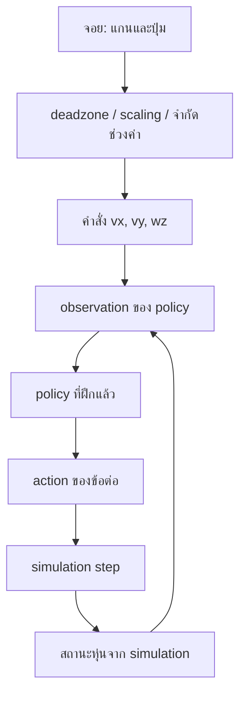

> เอกสารอ้างอิงเดิม: เก็บรายละเอียดและตัวอย่างเดิมไว้ ชื่อโครงการ `g1_training` และคำสั่งในไฟล์นี้ไม่ใช่ entry point ของโครงการใหม่ ให้เริ่มที่ [README](../../README.md) และ [แผนหลัก](../implementation_plan.md) ก่อนใช้งาน

# แผนสร้างโปรเจคทดลองฝึก Unitree G1

เอกสารนี้เสนอแนวทางสร้างโปรเจคส่วนตัวเพื่อศึกษา **การฝึก G1 ให้ยืน เดินตามคำสั่งความเร็ว และบังคับด้วยจอยใน simulation** โดยใช้ `unitree_rl_mjlab` ที่มีอยู่เป็นฐาน

สถานะ: เป็นแผนการพัฒนา ยังไม่ได้สร้าง package, task หรือสคริปต์ตามโครงสร้างที่เสนอ และยังไม่ได้ทดสอบการฝึก

## 1. วางโปรเจคไว้ที่ไหน

สร้าง `g1_training/` ข้างโปรเจคต้นทางภายใน workspace:

```text
/home/luke/nvidia/unitree/
├── unitree_rl_mjlab/       # ฐาน task และระบบฝึก/deploy ของ Unitree
├── g1_training/           # โค้ดและการทดลองของเรา — เสนอให้สร้าง
├── g1_locomotion/         # คู่มือและ keyboard controller เดิม
└── PROJECT_OVERVIEW_TH.md
```

ใช้ `unitree_rl_mjlab` เป็น dependency และต้นแบบของ task โดยแยกโค้ดทดลองไว้ใน `g1_training` เพื่อให้อัปเดตต้นทางและติดตามการเปลี่ยนแปลงของเราได้ง่าย เริ่มจาก wrapper บาง ๆ และ config ที่ปรับจากฐาน ไม่จำเป็นต้องคัดลอกทั้งโปรเจคหรือเขียน PPO และโมเดลหุ่นใหม่

ขอบเขตแรกคือ simulation ส่วน deployment ไปยังหุ่นจริงเป็นขั้นต่อไปหลังตรวจพฤติกรรมและความเข้ากันได้ของ controller แล้ว

## 2. โครงสร้างไฟล์ที่เสนอ

```text
g1_training/
├── README.md                  # วิธีติดตั้ง เทรน และทดลอง
├── pyproject.toml              # package และ dependency ของเรา
├── .gitignore                 # ยกเว้น logs/checkpoints และไฟล์ชั่วคราว
│
├── src/g1_training/
│   ├── __init__.py
│   ├── tasks/
│   │   ├── __init__.py         # ลงทะเบียน task ของเรา
│   │   ├── stand_env_cfg.py    # config ฝึกยืน
│   │   ├── walk_env_cfg.py     # config ฝึกเดิน
│   │   └── rl_cfg.py           # ค่า PPO และชื่อ experiment
│   │
│   └── control/
│       ├── __init__.py
│       ├── velocity_command.py # คำสั่งกลาง vx, vy, wz
│       └── gamepad.py          # อ่านจอย ปรับ deadzone และช่วงค่า
│
├── scripts/
│   ├── train.py               # โหลด task ของเราแล้วเรียก training
│   ├── play.py                # ดูพฤติกรรมจาก checkpoint
│   └── joystick_play.py       # บังคับ policy ด้วยจอยใน simulation
│
├── docs/
│   └── experiments.md         # บันทึกการเปลี่ยนแปลงและผลทดลอง
│
└── logs/                      # checkpoint, config และกราฟการฝึก
```

### หน้าที่ของไฟล์หลัก

| ไฟล์ | สิ่งที่ควรรับผิดชอบ |
| --- | --- |
| `pyproject.toml` | ทำให้ติดตั้งและ import `g1_training` ได้ ระบุ dependency เพิ่มเติมที่ใช้จริง |
| `tasks/__init__.py` | ลงทะเบียนชื่อ task ที่แยกจากต้นทาง เช่น `Custom-G1-Stand-Flat` และ `Custom-G1-Walk-Flat` |
| `stand_env_cfg.py` | สร้าง config ใหม่จากฐาน G1 แล้วกำหนดคำสั่งความเร็วเป็นศูนย์ ปรับ reward และเงื่อนไขการฝึกยืน |
| `walk_env_cfg.py` | สร้าง config เดิน กำหนดช่วงความเร็ว สัดส่วนคำสั่งหยุด และ reward สำหรับติดตามคำสั่ง |
| `rl_cfg.py` | กำหนดชื่อ experiment, seed, จำนวน iteration และค่า PPO โดยเริ่มจากค่าฐาน |
| `velocity_command.py` | เก็บคำสั่งความเร็ว จำกัดช่วงค่า และจัดการการกลับสู่คำสั่งศูนย์ |
| `gamepad.py` | อ่านแกนและปุ่มของจอย แปลงเป็นคำสั่งกลาง โดยไม่ผูก logic ของ policy ไว้ในตัวอ่านจอย |
| `train.py` / `play.py` | import task ของเราให้ลงทะเบียนก่อนเรียกใช้ runner และ environment ของฐาน |
| `joystick_play.py` | โหลด policy สร้าง environment แบบ play แล้วส่งคำสั่งจากจอยให้ command term |

ชื่อ `Custom-G1-*` เป็นชื่อที่เสนอ ยังไม่มีใน registry ปัจจุบัน การทำ wrapper ต้องตรวจ API ของเวอร์ชันที่ติดตั้งก่อน ไม่ควรสมมติว่าสามารถ import entry point ของต้นทางได้ทุกตัวโดยไม่ปรับ

## 3. Environment และความสัมพันธ์กับโปรเจคเดิม

สร้าง Python environment แยกสำหรับงานนี้ และติดตั้ง `unitree_rl_mjlab` กับ `g1_training` แบบ editable ใน environment เดียวกัน เพื่อให้การแก้โค้ดของเราใช้งานได้โดยไม่ต้องติดตั้งใหม่ทุกครั้ง

[setup.py ของฐาน](../../../unitree_rl_mjlab/setup.py) ระบุ `mjlab==1.2.0` และ `mujoco-warp==3.5.0` ให้เริ่มจาก [คู่มือติดตั้งของฐาน](../../../unitree_rl_mjlab/doc/setup_en.md) แล้วบันทึกเวอร์ชันและ commit ที่ใช้จริงในแต่ละการทดลอง

ตัวอย่างการติดตั้งหลังสร้างและ activate environment ตามคู่มือ และสร้าง `g1_training/pyproject.toml` แล้ว:

```bash
cd /home/luke/nvidia/unitree
python -m pip install -e ./unitree_rl_mjlab
python -m pip install -e ./g1_training
```

ไม่ต้องติดตั้ง ROS 2, XR หรือ LeRobot เพื่อเริ่มฝึก locomotion เส้นทางนี้

### แล้ว `g1_locomotion` ใช้ทำอะไรต่อ

เก็บไว้เป็นคู่มือและตัวอย่างการรับคำสั่งจากผู้ใช้ โดยเฉพาะ [keyboard_play.py](../../../g1_locomotion/scripts/keyboard_play.py) แต่ไม่จำเป็นต้องใช้เป็นฐานของโปรเจคใหม่

สคริปต์เดิมใช้ task `Mjlab-Velocity-Flat-Unitree-G1` จาก environment ของ `/home/luke/nvidia/mjlab` ขณะที่ฐาน `unitree_rl_mjlab` มี task `Unitree-G1-Flat` ของตัวเอง จึงต้องปรับการลงทะเบียน task และตรวจ API ก่อนย้ายความสามารถเข้ามา

Checkpoint จากสองเส้นทางยังไม่ควรถือว่าใช้ร่วมกันได้ ต้องตรวจ observation, action, joint order, normalization และโครงสร้าง policy ก่อน

## 4. ลำดับการทดลอง

### ขั้นที่ 0: ตรวจ baseline ของฐาน

ก่อนเปลี่ยน config ให้ตรวจว่า environment และ task ของต้นทางทำงานได้ เพื่อแยกปัญหาการติดตั้งออกจากปัญหาในการออกแบบ task ของเรา

```bash
cd /home/luke/nvidia/unitree/unitree_rl_mjlab
python scripts/list_envs.py
```

ตรวจว่ามี `Unitree-G1-Flat` แล้วใช้ขั้นตอน train/play จาก [README ของฐาน](../../../unitree_rl_mjlab/README.md) จำนวน environment ควรเริ่มให้เหมาะกับทรัพยากรเครื่อง บันทึก baseline ไว้เทียบกับการเปลี่ยนแปลงภายหลัง

### ขั้นที่ 1: ฝึกยืน

เริ่มจาก config G1 บนพื้นเรียบ ตั้งคำสั่ง `(vx, vy, wz)` เป็นศูนย์ และตรวจไม่ให้กลไกสุ่มคำสั่งหรือ heading เปลี่ยนเป้าหมายระหว่าง episode

สิ่งที่ศึกษาในขั้นนี้:

- Observation: policy เห็นข้อมูลอะไร เช่น ทิศทางแรงโน้มถ่วง ความเร็วเชิงมุม และสถานะข้อต่อ
- Action: policy ควบคุมค่าใดของข้อต่อ และมี scaling อย่างไร
- Reward: การรักษาท่าทาง สมดุล ความนิ่ง และการใช้แรงสัมพันธ์กันอย่างไร
- Termination: จบ episode เมื่อใด เช่น ล้มหรือหมดเวลา

เริ่มจาก reward ที่ฐานมีอยู่ แล้วค่อยปรับทีละส่วน การตั้งคำสั่งความเร็วเป็นศูนย์อย่างเดียวไม่ได้รับประกันว่าท่ายืนจะดี ต้องดูพฤติกรรมและ reward ร่วมกัน

เกณฑ์สังเกต: ยืนได้นานแค่ไหน มีการสั่นหรือไถลหรือไม่ ใช้ท่าทางผิดธรรมชาติหรือไม่ และฟื้นตัวจากแรงรบกวนได้แค่ไหน

### ขั้นที่ 2: ฝึกเดินตามคำสั่ง

สุ่มคำสั่งความเร็วในช่วงเล็กก่อน แล้วค่อยเพิ่มความยาก โดยเก็บบางช่วงเป็นคำสั่งศูนย์เพื่อให้ policy ฝึกหยุดและยืนด้วย

| คำสั่ง | ความหมาย |
| --- | --- |
| `vx` | ความเร็วเดินหน้า/ถอยหลัง หน่วย m/s |
| `vy` | ความเร็วด้านข้าง หน่วย m/s |
| `wz` | ความเร็วหมุนรอบแกนตั้ง หน่วย rad/s |

ตรวจ coordinate frame และทิศเครื่องหมายจาก command term ของฐานก่อนเชื่อม input ภายนอก

เกณฑ์สังเกต: ความคลาดเคลื่อนระหว่างความเร็วจริงกับคำสั่ง การเลี้ยว การเปลี่ยนความเร็ว การหยุด และความถี่ที่ล้ม ควรตรวจทั้งกราฟและการเปิดดู policy

**ไม่จำเป็นต้องฝึกยืนแยกก่อนเสมอไป** การแยก task ช่วยให้ศึกษาได้เป็นขั้น แต่ task เดินสามารถเรียนรู้ทั้งยืนและเดินร่วมกันได้ หากจะนำ checkpoint ยืนไปฝึกเดินต่อ ต้องรักษา observation/action และโครงสร้างโมเดลให้เข้ากัน รวมถึงแยกให้ชัดว่าต้องการ resume ทั้ง optimizer หรือโหลดเฉพาะน้ำหนัก policy

### ขั้นที่ 3: บังคับด้วยจอย

โหลด policy ที่เดินตามคำสั่งได้แล้ว และเปลี่ยนแหล่งคำสั่งจากการสุ่มเป็นจอย ไม่ต้องเสียบจอยระหว่างฝึก



Mapping เริ่มต้นที่เสนอ:

| Input | คำสั่ง |
| --- | --- |
| แกนซ้ายขึ้น/ลง | `vx` เดินหน้า/ถอยหลัง |
| แกนซ้ายซ้าย/ขวา | `vy` เดินด้านข้าง |
| แกนขวาซ้าย/ขวา | `wz` หมุนตัว |
| ปุ่มหยุด | ตั้งคำสั่งทั้งสามแกนเป็นศูนย์ |
| จอยหลุดหรือข้อมูล input ค้าง | กลับไปใช้คำสั่งศูนย์ |

หมายเลขแกนและทิศเครื่องหมายต้องตรวจจากจอยจริง ไม่ควร hard-code จากชื่อรุ่นเพียงอย่างเดียว

`gamepad.py` ควรจัดการ deadzone เพื่อตัดค่ารบกวนใกล้ศูนย์ และ scale ให้ไม่เกินช่วงที่ฝึกมา ส่วน `joystick_play.py` ต้องปิดหรือแทนที่การสุ่มคำสั่ง เพื่อให้ค่าจากจอยไปถึง observation ของ policy ในแต่ละ step

ปุ่มหยุดใน workflow นี้คือการสั่งให้ policy หยุดเดิน ไม่ใช่การตัดแรงบิดมอเตอร์

## 5. บันทึกการทดลองอย่างไร

เก็บ checkpoint, config และกราฟไว้ใต้ `logs/` แยกตามชื่อ experiment และรอบการฝึก พร้อมกำหนด output path ในสคริปต์ให้ชัดเจน ไม่ให้ขึ้นกับ directory ที่เปิด terminal โดยไม่ตั้งใจ

ใช้ `docs/experiments.md` บันทึกสั้น ๆ ต่อหนึ่งการทดลอง:

| รายการ | สิ่งที่บันทึก |
| --- | --- |
| Run | ชื่อ run, task และวันที่ |
| เวอร์ชัน | commit ของโค้ดเรา/ฐาน และเวอร์ชัน dependency |
| Config | seed, จำนวน environment, iteration และ config ที่บันทึกไว้ |
| เปลี่ยนอะไร | เช่น น้ำหนัก reward หนึ่งตัว หรือช่วงความเร็ว |
| ผล | ระยะเวลายืน อัตราการล้ม ความแม่นยำตามคำสั่ง และพฤติกรรมที่เห็น |
| หลักฐาน | path ของ checkpoint, กราฟ และวิดีโอถ้ามี |
| ทดลองต่อ | สมมติฐานที่จะทดสอบในรอบถัดไป |

เริ่มจากเปลี่ยนทีละเรื่องและเทียบกับ baseline หากต้องการสรุปว่าการปรับปรุงดีขึ้นจริง ค่อยตรวจหลาย seed เพื่อลดผลจากความสุ่ม

## 6. ขอบเขตงานรุ่นแรก

1. สร้าง package และ environment ของ `g1_training`
2. ลงทะเบียน task ยืนและเดิน โดยใช้ config G1 ของฐาน
3. ทำ entry point สำหรับ train/play และกำหนดตำแหน่ง logs
4. ตรวจว่าฝึก บันทึก checkpoint และโหลดกลับมา play ได้
5. เพิ่มตัวอ่านจอยและเชื่อมคำสั่งเข้ากับ environment
6. ตรวจ deadzone, ทิศแกน, ปุ่มหยุด และการกลับสู่คำสั่งศูนย์เมื่อจอยขาดการเชื่อมต่อ
7. เขียน README จากคำสั่งที่ทดสอบจริง พร้อมบันทึก baseline แรก

เริ่มอ่านโค้ดจาก [config G1 ของฐาน](../../../unitree_rl_mjlab/src/tasks/velocity/config/g1/env_cfgs.py), [velocity environment](../../../unitree_rl_mjlab/src/tasks/velocity/velocity_env_cfg.py) และ [training script](../../../unitree_rl_mjlab/scripts/train.py) ประกอบกับ [ภาพรวม workspace](../../../PROJECT_OVERVIEW_TH.md)
